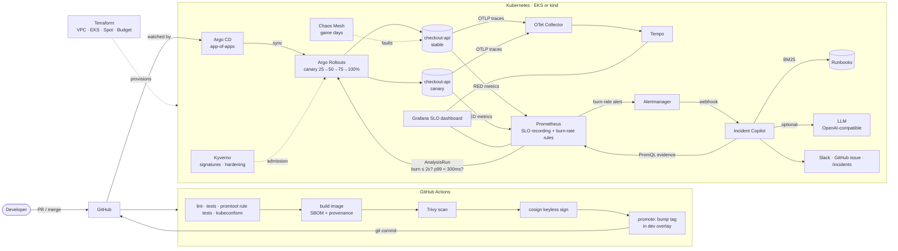
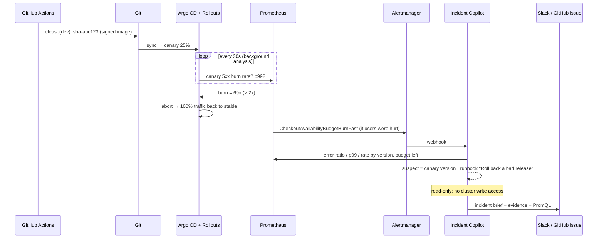

# Sentinel — SLO-driven, self-healing delivery platform

[](https://github.com/marwin226/sentinel-slo-platform/actions/workflows/ci.yml)
[](https://github.com/marwin226/sentinel-slo-platform/actions/workflows/iac.yml)


> **Bad releases get caught and rolled back by the error budget — not by a tired human at 3 a.m.
> And before anyone is paged, an AI SRE copilot has already written the incident brief.**

Sentinel is an end-to-end reference platform for running a service on Kubernetes the way SRE teams do it in 2026:
**SLOs as code → multi-window burn-rate alerts → SLO-gated canary releases with automatic rollback →
evidence-first AI incident triage**, delivered entirely through GitOps on infrastructure defined in Terraform.

---

## Why this exists

Most "DevOps projects" stop at *"the pipeline deploys to Kubernetes."* The hard part of production is what happens
**after** the deploy: is the new version actually hurting users, how fast, and what should the on-call do about it?
Sentinel answers those questions with the error budget as the single source of truth:

| Question | How Sentinel answers it |
|---|---|
| Is the new build hurting users? | Argo Rollouts canary queries Prometheus **scoped to the canary's pod-template hash**, so healthy stable traffic can't mask a bad build. Burn > 2x or p99 > 300 ms → automatic abort. |
| Is the service in trouble right now? | Multi-window, multi-burn-rate alerts (Google SRE Workbook) generated from a 20-line SLO spec. Fast burn pages, slow burn tickets. |
| What should on-call do? | The **incident copilot** pulls hard evidence from Prometheus, identifies the suspect version, retrieves the exact runbook procedure, and (optionally) asks an LLM to write a brief — **read-only by design**. |
| Can we trust the alerts? | Alerting rules have **unit tests** (`promtool test rules`): a bad release must page; a healthy service must stay quiet. |
| Can we trust what runs? | Images are scanned (Trivy), carry SBOM + SLSA provenance, are **cosign-signed keylessly**, and Kyverno verifies signatures and hardening at admission. |
| Will it survive failure? | Chaos Mesh game days with written hypotheses: pod kills, network latency, CPU stress. |
| What does it cost? | Spot node groups, single NAT in dev, mandatory cost tags, and an AWS Budget alert — all in Terraform. |

## Architecture



### What a bad release looks like



## Proof it works

Verified on 2026-10-18 by running the real components together (stable v1.4.0 + a bad canary v1.5.0 injecting
40% 5xx, real Prometheus 3.5 + Alertmanager 0.28 evaluating the generated rules):

- **~30 s** from traffic start to `CheckoutAvailabilityBudgetBurnFast` firing (1h burn rate measured at **33.8x**).
- **~15 s** later the copilot had produced a brief naming **v1.5.0** as the suspect (error ratio 37.6% vs 0.00% for v1.4.0)
  and citing **"Roll back a bad release"** as the first procedure → [full captured output](docs/demo/sample-incident-brief.md).
- Canary gate PromQL against the same data: bad canary burn **69x** → fail; stable → pass.
- `promtool test rules`: bad release pages at 15 min; a 0.1%-error service never pages; probe traffic never counts.

| Check (all in CI) | Result |
|---|---|
| Unit tests (27) + coverage gate 80% | checkout-api 89%, incident-copilot 87% |
| SLO rules: `promtool check` + `promtool test` | 26 rules, 3 alert test scenarios pass |
| SLO rules regenerated from spec, no drift | ✅ |
| `kubeconform -strict` on all rendered overlays incl. Rollout/AnalysisTemplate/PodMonitor/Kyverno/Argo CRDs | ✅ |
| `terraform fmt` / `validate` / `tflint` / Checkov | in `iac` workflow |

## Quick start

### 1 · Five-minute demo (Docker only)

```bash
git clone https://github.com/marwin226/sentinel-slo-platform && cd sentinel-slo-platform
docker compose up --build            # optional: cp .env.example .env and add a free Groq key
# after ~1-2 min:
curl -s localhost:8081/incidents/latest.md
```
Grafana at <http://localhost:3000> opens on the **Sentinel / checkout-api SLO** dashboard.
Set `CANARY_ERROR_RATE=0` to watch a healthy canary stay silent.

### 2 · Full platform on a local cluster (kind, free)

```bash
make cluster                       # kind + Argo CD + everything else via GitOps
kubectl get applications -n argocd -w
make bad-release && git commit -am "release: 0.3.0-bad" && git push
kubectl argo rollouts get rollout checkout-api -n checkout -w   # watch it abort itself
```
Requires `kind`, `kubectl`, `helm`, `docker`, `yq`. Fork the repo first and update `repoURL` in
`platform/argocd/` so Argo CD watches your fork.

### 3 · AWS (EKS)

```bash
cd infra/terraform/aws
cp terraform.tfvars.example terraform.tfvars   # set your IP + budget email
terraform init && terraform apply              # ~15 min
$(terraform output -raw configure_kubectl)
../../../scripts/bootstrap.sh current
```
Rough dev cost: EKS control plane ~$73/mo + 3 Spot `*.large` nodes + 1 NAT gateway — the Terraform creates an
AWS Budget alert at 80% forecast. Run `terraform destroy` when you are done. See [docs/cost.md](docs/cost.md).

## Repository map

```text
services/
  checkout-api/          FastAPI service · RED metrics · OTel traces · fault injection · load generator
  incident-copilot/      Alertmanager webhook → PromQL evidence → BM25 runbook retrieval → LLM brief
slo/checkout-api.yaml    SLOs as code (availability 99.5%, latency 99% < 300 ms)
scripts/
  generate_slo_rules.py  spec → multi-window multi-burn-rate rules (+ --check for CI drift)
  bootstrap.sh           kind/EKS → Argo CD → app-of-apps
  release.sh             good / bad / slow release for the canary demo
observability/           generated rules · promtool unit tests · local Prometheus/Alertmanager/Grafana config
deploy/                  Kustomize: Rollout + SLO AnalysisTemplate + PodMonitor + HPA + PDB + NetworkPolicy
platform/
  argocd/                app-of-apps (kube-prometheus-stack, Argo Rollouts, Kyverno, Chaos Mesh, OTel, Tempo…)
  values/                pinned Helm values
  policies/              Kyverno guardrails incl. cosign signature verification
  chaos/                 game-day experiments with hypotheses
  observability/         PrometheusRules + Grafana dashboard (ConfigMap)
infra/
  terraform/aws/         VPC (3 AZ) · EKS · Spot node group · flow logs · AWS Budget
  kind/                  local cluster
docs/                    runbooks · ADRs · SLO policy · game days · postmortem template · security · cost
.github/workflows/       ci · iac · release (build → scan → SBOM → sign → GitOps promote)
```

## Design decisions

Short ADRs in [`docs/adr/`](docs/adr):
1. [Error budget, not a static threshold, gates releases](docs/adr/0001-slo-gated-canary.md)
2. [The AI copilot is read-only and evidence-first](docs/adr/0002-read-only-ai-copilot.md)
3. [GitOps pull model with Argo CD instead of `kubectl apply` from CI](docs/adr/0003-gitops-pull-model.md)

## Tech stack

**Cloud & IaC:** AWS (VPC, EKS, Budgets), Terraform, terraform-aws-modules, kind ·
**Delivery:** GitHub Actions, GHCR, Docker Buildx, Argo CD (app-of-apps), Argo Rollouts, Kustomize, Helm ·
**Observability:** Prometheus Operator, Alertmanager, Grafana, OpenTelemetry Collector, Tempo ·
**Reliability:** SLOs/error budgets, multi-window burn-rate alerting, promtool rule tests, Chaos Mesh, runbooks, postmortems ·
**Security:** Kyverno, cosign/Sigstore keyless signing, SBOM + SLSA provenance, Trivy, Checkov, NetworkPolicies, non-root read-only containers ·
**Code:** Python 3.12, FastAPI, pytest, ruff · **AI:** OpenAI-compatible LLM API (Groq by default), BM25 retrieval

## Roadmap

- [ ] Gateway API traffic splitting (exact canary weights independent of replica count)
- [ ] Per-tenant SLOs and an error-budget policy bot that freezes non-critical releases
- [ ] Karpenter for node autoscaling; OpenCost for per-namespace cost reporting
- [ ] Copilot: Loki log evidence and a "draft the revert PR" action behind human approval

---
Built by **Marwin serrao** · [LinkedIn](https://www.linkedin.com/in/marwin-serrao-543333173/) · [GitHub](https://github.com/marwin226) · MIT licensed
